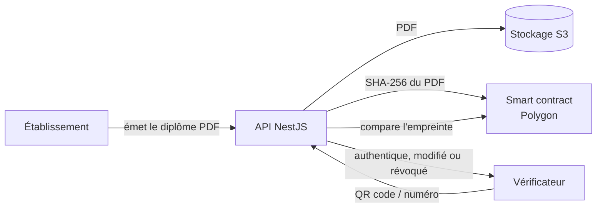

# INUBIL Verify

Plateforme de certification et de vérification de diplômes sur blockchain, réalisée pour ISTAMA INUBIL (Douala, Cameroun).

L'établissement émet un diplôme ; son empreinte est inscrite sur la blockchain Polygon. N'importe qui (recruteur, université partenaire) peut ensuite vérifier en quelques secondes, avec un QR code ou un numéro, que le diplôme est authentique, n'a pas été modifié et n'a pas été révoqué.

**Démo :** https://inubil-verify.onrender.com

## Fonctionnement



Le smart contract `InubilVerify.sol` ne stocke que l'empreinte SHA-256 du PDF, l'identifiant de l'université et la date d'émission. Aucune donnée personnelle n'est écrite sur la blockchain. Un diplôme révoqué reste inscrit et est marqué comme tel.

## Fonctionnalités

- **Émission de diplômes** : génération du PDF avec QR code, enregistrement sur la blockchain, envoi par e-mail à l'étudiant
- **Vérification publique** par QR code ou numéro unique, sans compte
- **Révocation** d'un diplôme, avec registre public des révocations
- **Espace étudiant** (web et mobile) : consultation des diplômes, partage par lien avec un recruteur
- **Gestion de l'établissement** : universités, départements, filières, mentions, types de documents, étudiants, invitations
- **Partenaires** : clés d'API et webhooks pour vérifier des diplômes depuis un autre système
- **Sécurité** : rôles et permissions, journal d'audit, limitation du nombre de requêtes, sauvegardes planifiées

## Stack technique

| Couche | Technologie |
|---|---|
| Blockchain | Solidity 0.8, Hardhat, Ethers.js v6, Polygon (réseau de test Amoy) |
| Backend | NestJS, Prisma, PostgreSQL 16 |
| Frontend web | React, Vite |
| Mobile | Flutter |
| Stockage des fichiers | AWS S3 (compatible Cloudflare R2) |
| Documents | PDFKit, QR codes |
| Déploiement | Docker, Docker Compose, Render |

## Structure du dépôt

```
backend/               API NestJS (Swagger sur /api/docs)
blockchain/            smart contract, tests et scripts de déploiement Hardhat
inubil-verify-front/   application web React
mobile/                application mobile Flutter
docs/                  guides techniques (S3, Polygon, API front, workflow Git)
```

## Lancer le projet

```bash
cp .env.example .env
# Renseigner les valeurs dans .env
docker-compose up
```

| Service | URL |
|---|---|
| API | http://localhost:3000 |
| Swagger | http://localhost:3000/api/docs |
| Application web | http://localhost:5173 |
| pgAdmin | http://localhost:5050 |

## Tests

```bash
cd blockchain && npx hardhat test   # smart contract
cd backend && npm test              # API
```

## Documentation

- [Base de données](DATABASE.md)
- [Stockage AWS S3](docs/guide-aws-s3.md) et [Cloudflare R2](docs/guide-cloudflare-r2.md)
- [Blockchain Polygon](docs/guide-blockchain-polygon.md)
- [API pour le frontend](docs/guide-frontend-api.md)
- [Rôles et pages](docs/ROLES_ET_PAGES.md)
- [Workflow Git](docs/GUIDE_WORKFLOW.md)

## Équipe

- **Flanc Bel** ([@BelCodeur2005](https://github.com/BelCodeur2005)) : backend, blockchain
- **Belvie Scindie** ([@NGANGUE-conception](https://github.com/NGANGUE-conception)) : frontend
